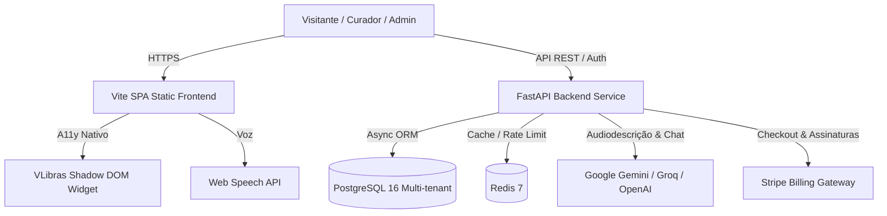

# Lumiar Platform

> **Acessibilidade conectada para espaços culturais, serviços e experiências.**

Plataforma SaaS da Lumiar para gestão de acervos, audiodescrição assistida por inteligência artificial, curadoria acessível e experiências digitais inclusivas conforme as diretrizes **WCAG 2.2 AA**, **eMAG 3.1** e a **Lei Brasileira de Inclusão (LBI — Lei nº 13.146/2015)**.

[](apps/api)
[](apps/web)
[](apps/web)
[](apps/web)
[](render.yaml)

---

## Sumário
1. [Visão Geral dos Produtos](#visão-geral-dos-produtos)
2. [Principais Inovações e Recursos do Frontend](#principais-inovações-e-recursos-do-frontend)
3. [Tecnologias e Padrões de Arquitetura](#tecnologias-e-padrões-de-arquitetura)
   - [Frontend](#resumo-de-tecnologias---frontend)
   - [Backend & Inteligência Artificial](#resumo-de-tecnologias---backend--ia)
   - [Padrões de Projeto e Arquitetura](#padrões-de-projeto-e-arquitetura)
4. [Estrutura do Projeto](#estrutura-do-projeto)
5. [Execução Local](#execução-local)
6. [Rotas e Páginas da Aplicação](#rotas-e-páginas-da-aplicação)
7. [Segurança e Conformidade LGPD](#segurança-e-conformidade-lgpd)
8. [Deploy e Validação](#deploy-e-validação)

---

## Visão Geral dos Produtos

O ecossistema Lumiar é estruturado em três soluções modulares integradas:

| Solução | Público e Aplicação | Recursos Principais | Estado |
| :--- | :--- | :--- | :--- |
| **Lumiar Cultural** | Museus, galerias, centros culturais e memoriais | Gestão de acervos, audiodescrição inteligente com IA, totens táteis, QR Codes dinâmicos e curadoria multissensorial. | **Disponível** |
| **Lumiar Guia** | Espaços públicos, parques, eventos e instituições | Orientação espacial acessível, rotas inteligentes, suporte multiformato para pessoas com deficiência física e sensorial. | **Disponível** |
| **Lumiar Turismo** | Cidades históricas, secretarias de turismo e atrações | IA Generativa para conectar visitantes a destinos, patrimônios acessíveis e assistência virtual com a Lumi. | **Disponível** |

---

## Principais Inovações e Recursos do Frontend

O frontend da Lumiar foi projetado seguindo rigorosamente a conformidade **WCAG 2.2 AA**, com layout moderno, responsivo e de alto impacto visual:

### 1. Banner Hero Carrossel Proporcional (`LumiarHeroCarousel.tsx`)
- Altura proporcional adaptativa (`h-[380px]` no mobile até `h-[480px]` em desktops), eliminando deformações verticais.
- Rotação automática suave a cada 4 segundos com transição contínua.
- Controles interativos com setas laterais e marcadores de paginação no rodapé do carrossel.
- Textos com tipografia branca, sombras de contraste e layout responsivo.

### 2. Seção "O que é o Lumiar?" (`QuemSomosSection.tsx`)
- Arquitetura split com CSS Grid Stacking e Glassmorphism inspirada nas melhores práticas de acessibilidade (*IncluTalk*).
- Imagem nativa em alta definição com enquadramento de cobertura (`object-cover`) e cantos arredondados (`border-radius: 28px`).
- Destaques de texto, eyebrow com badge luminosa e citação de impacto com borda cyan `#06b6d4`.

### 3. Seção de Indicadores Estatísticos de Impacto (`LumiarIndicadoresSection.tsx`)
- **Dados Oficiais do Censo IBGE 2022**: Apresenta a urgência da acessibilidade digital e comunicacional no Brasil.
- **Tipografia Centralizada Forte**: Título principal, texto descritivo com largura controlada (`max-w-[926px]`) e citação destacada em itálico.
- **Grid Responsivo de 6 Indicadores Percentuais**:
  - **7,3%**: População brasileira com algum tipo de deficiência (aprox. 1 em cada 14 pessoas).
  - **4,0%**: Dificuldade permanente para enxergar.
  - **2,6%**: Dificuldade para andar ou subir degraus.
  - **1,4%**: Dificuldade para pegar objetos pequenos ou abrir tampas.
  - **1,4%**: Limitações nas funções mentais/intelectuais.
  - **1,3%**: Dificuldade permanente para ouvir.
- **Animação Progressiva Inicial (Counter Animation)**:
  - Animação de contagem suave (curva `easeOutCubic`) acionada via `IntersectionObserver` assim que os números entram no campo de visão.
  - Totalmente adaptada à preferência `prefers-reduced-motion` do sistema e acompanhada de atributos ARIA para leitores de tela.

### 4. Seção de Acessibilidade Digital & LBI (`LumiarAcessibilidadeSection.tsx`)
- Enquadramento na **Lei Brasileira de Inclusão (LBI nº 13.146/2015)** e conexão com os **Objetivos de Desenvolvimento Sustentável da ONU**: ODS 4 (Educação Inclusiva), ODS 10 (Redução das Desigualdades) e ODS 11 (Cidades Inclusivas e Sustentáveis).
- Cartão de mídia com o mesmo contorno superior cyan `#06b6d4`, sombras e efeitos de hover de "O que é o Lumiar?".
- Mapeamento das âncoras `#sustentabilidade` e `#acessibilidade`.

### 5. Painel Flutuante de Ferramentas Assistivas (A11y Toolbar)
- **12 Recursos Interativos**:
  1. Aumentar Fonte (`A+`)
  2. Diminuir Fonte (`A-`)
  3. Fonte para Dislexia (*OpenDyslexic*)
  4. Modo Monocromático (Escala de cinza)
  5. Aumentar Saturação
  6. Diminuir Saturação
  7. Ocultar Imagens
  8. Modo Leitura (foco e contraste tipográfico)
  9. Cursor Ampliado
  10. **Libras Integrado**: Aciona diretamente o widget nativo **VLibras** na própria página do site via Shadow DOM, sem direcionar para URLs externas do governo federal.
  11. **Leitura em Voz Alta**: Síntese de voz com a *Web Speech API* nativa do navegador (Play, Pause e Stop).
  12. Alto Contraste (modo escuro com paleta WCAG 2.2 AA).
- **Ícones em SVG Vetorial Padronizados**: `dislexia.svg`, `monocromatico.svg`, `ocultar_imagem.svg`, `modo_leitura.svg`, `vlibras.svg` e `saturacao.svg`.
- **Botão "Redefinir Ajustes"**: Em azul oficial `#0284c7` com texto branco e tipografia institucional.
- **Crédito Oficial Lumiar**: Selo "Acessibilidade Digital por" com a nova logomarca colorida do farol.

### 6. Cabeçalho Unificado, Busca e Multilíngue
- Topbar com navegação fixa: **ACESSIBILIDADE**, **O QUE É**, **PRODUTOS**, **SUSTENTABILIDADE**, **EXPERIÊNCIA**, **CONTATO**.
- Botão **"ENTRAR"** global funcional na página inicial e nas páginas filhas (`/cultural`, `/guia`, `/turismo`).
- Seletor de idiomas multilíngue com persistência no `localStorage` e suporte a 5 variações: Português (Brasil), Português (Portugal), Inglês (EUA), Espanhol e Francês.
- Busca integrada por termos com rolagem e redirecionamento dinâmico.

### 7. Experiência de Login e Gestão Administrativa
- Botões **"Voltar para o portal"** e **"Entrar"** unificados no padrão visual azul `#0284c7`.
- Logomarca colorida oficial integrada à tela de login e ao cabeçalho do menu lateral (`aside .brand`).
- Botão **"Sair"** padronizado com o mesmo estilo, cor azul-petróleo e tipografia do botão *"Ver todos os espaços"*, redirecionando imediatamente para a raiz do portal (`/`).

### 8. Rodapé Institucional e Conformidade LGPD (`LumiarFooter.tsx`)
- Logomarca oficial do rodapé (`lumiar-logo-footer.png`), textos e links na cor branca.
- Caixa de segurança e transparência em conformidade com a **Lei Geral de Proteção de Dados (LGPD — Lei nº 13.709/2018)**.
- Modal interativo da **Política de Privacidade**, detalhando finalidades de tratamento, bases legais, direitos dos titulares e canal do encarregado (DPO).

---

## Tecnologias e Padrões de Arquitetura

### Resumo de Tecnologias - Frontend
- **Linguagem & Framework**: React 18, TypeScript 5, Vite 5.
- **Ícones & Vetores**: Lucide React + SVGs customizados acessíveis.
- **Design System & Estilização**: CSS Vanilla Modularizado (`portal-moderno.css`, `landing-polish.css`, `global.css`) com classes utilitárias inspiradas no Tailwind CSS para máxima performance e controle estrito de especificidade.
- **Acessibilidade**:
  - Diretrizes WCAG 2.2 Nível AA e eMAG 3.1.
  - Web Speech API (síntese de voz local para audiodescrição de tela).
  - VLibras Plugin com inicialização nativa no Shadow DOM.
  - Suporte completo a navegação por teclado (`focus-visible`, `outline` de 3px, Skip Links `Alt+1` e `Alt+A`).
  - Respeito à preferência do sistema operacional por `prefers-reduced-motion`.
- **Navegação & Roteamento**: Single Page Application (SPA) com History API nativa (`pushState`, `popstate`), sem recarregamentos desnecessários e com persistência de estado.

### Resumo de Tecnologias - Backend & IA
- **Linguagem & Framework**: Python 3.12, FastAPI (alta performance assíncrona com Starlette e Pydantic v2).
- **Banco de Dados Relacional**: PostgreSQL 16 com ORM assíncrono SQLAlchemy 2.0.
- **Cache & Filas**: Redis 7 para sessões e otimização de requisições.
- **Autenticação & Segurança**: Tokens JWT seguros, hashing de senhas com `bcrypt` (Passlib), isolamento multi-tenant por chave estrangeira obrigatória (`organization_id`).
- **Inteligência Artificial Multimodal**:
  - **Audiodescrição Inteligente**: Google GenAI SDK (Gemini 2.5 Flash) para análise de imagens de obras de arte e monumentos, gerando textos acessíveis segundo as normas do eMAG 3.0.
  - **Chat Assistivo Lumi**: Arquitetura multi-provedor com fallback inteligente (`auto`, `groq`, `openai`, `google`), com modelos Llama 3.3 70B, GPT-4o Mini e Gemini Flash.
- **Billing & Assinaturas**: Stripe API (Stripe Checkout Sessions hospedadas, Webhook assinado com HMAC e Billing Portal).

### Padrões de Projeto e Arquitetura



1. **Multi-Tenancy com Isolamento Estrito**:
   - Cada organização (museu, centro cultural ou município) opera em ambiente virtualmente isolado. Todas as consultas de acervo, espaços e curadores são vinculadas obrigatoriamente à instituição do usuário autenticado.
2. **Role-Based Access Control (RBAC)**:
   - Perfis hierárquicos: `superadmin` (operação global), `owner` (administrador da instituição), `admin` (gestor de acervo), `curator` (curador de obras e audiodescrições) e `member` (consulta).
3. **Decoupled Architecture (Frontend desacoplado do Backend)**:
   - As páginas públicas e comerciais do portal (`/`, `/cultural`, `/guia`, `/turismo`) carregam de forma instantânea via CDN e não dependem do banco de dados para abrir, proporcionando máxima pontuação no Core Web Vitals (LCP, FID/INP e CLS).
4. **Princípio da Degradação Graciosa em Acessibilidade**:
   - Caso um recurso assistivo avançado falhe ou não tenha suporte no navegador (ex.: falta de rede para sintetizador de voz ou VLibras), alternativas textuais, contraste e atalhos de teclado permanecem 100% funcionais.

---

## Estrutura do Projeto

```text
LUMIAR-APP/
├── apps/
│   ├── api/                      # Backend FastAPI (Python 3.12)
│   │   ├── app/
│   │   │   ├── api/v1/           # Rotas da API (auth, cultural, spaces, billing, etc.)
│   │   │   ├── core/             # Configurações, segurança e conexão com banco
│   │   │   ├── models/           # Entidades SQLAlchemy (User, Org, Item, Space, Audit)
│   │   │   ├── schemas/          # Validações Pydantic
│   │   │   └── services/         # Integrações IA (Gemini, Groq, OpenAI) e Stripe
│   │   ├── requirements.txt
│   │   └── reset_production_data.py
│   ├── mobile/                   # Aplicativo visitante em Flutter
│   └── web/                      # Frontend SPA em React 18 + Vite
│       ├── public/               # Mídias, ícones SVG e logomarcas oficiais
│       │   └── assets/           # Imagens de produtos, ODS, bandeiras e recursos A11y
│       ├── src/
│       │   ├── components/       # Componentes modulares
│       │   │   ├── LumiarHeroCarousel.tsx        # Banner carrossel dinâmico
│       │   │   ├── QuemSomosSection.tsx          # Seção O que é o Lumiar
│       │   │   ├── LumiarIndicadoresSection.tsx  # Métricas Censo IBGE 2022
│       │   │   ├── LumiarAcessibilidadeSection.tsx# LBI e ODS da ONU
│       │   │   ├── LumiarExperienceCards.tsx     # Pilares de experiência
│       │   │   ├── LumiarFooter.tsx              # Rodapé com LGPD e Privacidade
│       │   │   └── LumiarOdsSection.tsx          # Painel interativo de ODS
│       │   ├── styles/           # Folhas de estilo modularizadas
│       │   │   ├── portal-moderno.css            # Estilos mestres do portal e utilitários
│       │   │   ├── landing-polish.css            # Polimento visual de landing
│       │   │   └── global.css                    # Variáveis de sistema e dashboard
│       │   └── main.tsx          # Aplicação principal, rotas SPA, modal de Login e Dashboard
├── docs/                         # Documentação técnica e de produto
├── render.yaml                   # Infraestrutura como código (IaC) para o Render
└── README.md
```

---

## Execução Local

### Pré-requisitos
- Node.js 20+ e npm
- Python 3.12+ (ambiente virtual `.venv`)
- PostgreSQL 16 (ou container Docker)

### Inicialização Rápida

#### 1. Backend (FastAPI)
```bash
cd apps/api
python -m venv .venv
# No Windows PowerShell:
.\.venv\Scripts\Activate.ps1
# No Linux/Mac:
source .venv/bin/activate

pip install -r requirements.txt
uvicorn app.main:app --host 127.0.0.1 --port 8001 --reload
```
- API e documentação interativa: [http://127.0.0.1:8001/docs](http://127.0.0.1:8001/docs)

#### 2. Frontend (React + Vite)
```bash
cd apps/web
npm install
npm run dev
```
- Portal acessível no navegador: [http://localhost:5173/](http://localhost:5173/)

---

## Rotas e Páginas da Aplicação

| Rota | Descrição |
| :--- | :--- |
| `/` | Portal principal: Carrossel Hero, O que é o Lumiar, Indicadores IBGE 2022, Produtos, Acessibilidade LBI/ODS, Experiência, Contato e Rodapé LGPD. |
| `/cultural` | Página dedicada do **Lumiar Cultural**: recursos de curadoria, audiodescrição e gestão de museus. |
| `/guia` | Página dedicada do **Lumiar Guia**: mobilidade acessível e navegação em espaços físicos. |
| `/turismo` | Página dedicada do **Lumiar Turismo**: inteligência artificial para cidades e destinos inclusivos. |
| `/#o-que-e` | Âncora de rolagem direta para a seção "O que é o Lumiar?". |
| `/#sustentabilidade` | Âncora de rolagem para os compromissos com a LBI e ODS 4, 10 e 11. |
| `Modal Login` | Tela de autenticação institucional com alternância rápida para cadastro e atalhos de acessibilidade. |
| `Dashboard` | Painel autenticado para curadores e gestores (visão geral, acervo, espaços, organizações e auditoria). |

---

## Segurança e Conformidade LGPD

A plataforma foi construída em observância à **Lei nº 13.709/2018 (LGPD)**:
1. **Minimização de Dados**: Coleta estritamente os dados necessários para prestação do serviço e controle institucional.
2. **Isolamento de Credenciais**: Chaves secretas de APIs (`OPENAI_API_KEY`, `GOOGLE_API_KEY`, `GROQ_API_KEY`, `STRIPE_SECRET_KEY`) ficam armazenadas exclusivamente nas variáveis de ambiente do backend e nunca são expostas ao cliente web.
3. **Pagamentos Seguros**: Nenhuma informação sensível de pagamento (número de cartão de crédito, CVV) trafega ou é gravada nos servidores da Lumiar; todo o fluxo é delegado ao *Stripe Checkout*.
4. **Canal de Direitos dos Titulares**: Disponibilização do canal do encarregado de dados (`lumiar@lumiar.com.br`) e modal da Política de Privacidade acessível no rodapé em qualquer página.

---

## Deploy e Validação

### Testes e Verificação de Tipos
```bash
# Validação de Tipagem do Frontend
node apps/web/node_modules/typescript/bin/tsc --noEmit -p apps/web/tsconfig.json

# Testes Unitários e de Cobertura do Backend
cd apps/api
pytest --cov=app
```

### Blueprint de Deploy no Render
O arquivo [`render.yaml`](render.yaml) provisiona automaticamente os dois serviços:
1. **`lumiar-web`**: Static Site hospedado na CDN global do Render com suporte a HTTPS e compactação gzip/brotli.
2. **`lumiar-api`**: Web Service Python com escala automática e variáveis protegidas para conexão com banco e gateways de IA.

---

**© 2026 Grupo Lumiar — Acessibilidade Conectada. Todos os direitos reservados.**
